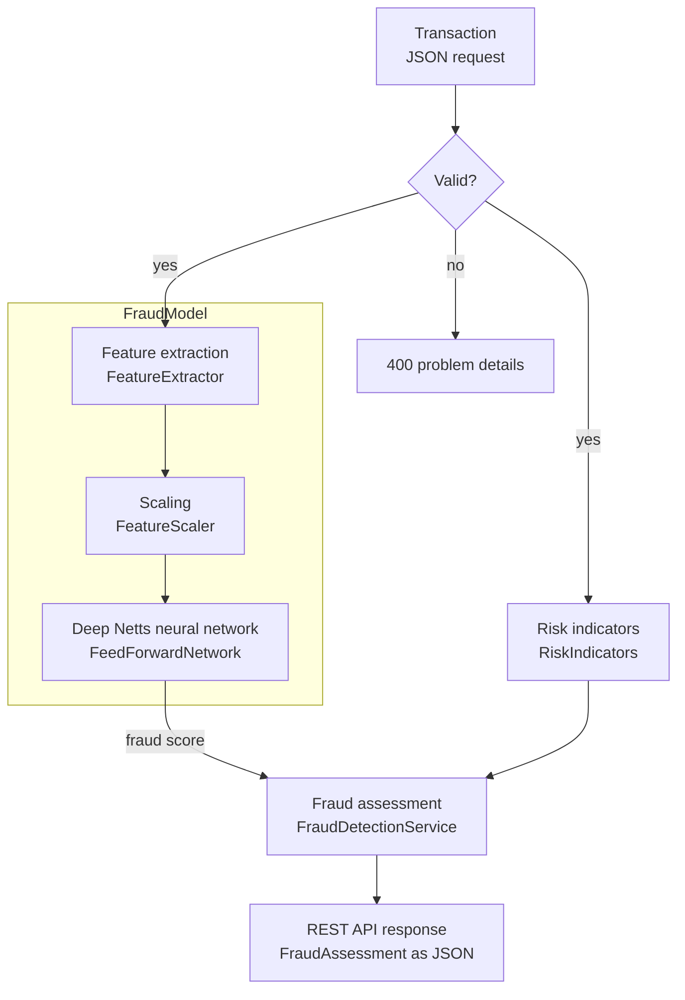

# Fraud Detection with Deep Netts: Extended Example

A Java proof of concept that scores card transactions for fraud through a REST API, using a feed-forward neural network trained with [Deep Netts](https://www.deepnetts.com). This extended example covers the full machine learning lifecycle. For the smallest complete integration, start with the [minimal example](../minimal/README.md). The [repository README](../README.md) compares the two.

**Built with:** Java 25, Spring Boot 4.0, Deep Netts 4.0.4 (`com.deepnetts:deepnetts-core`) and Maven.

**Contents:** [Overview](#overview) · [Architecture](#architecture) · [Key Features](#key-features) · [Quick Start](#quick-start) · [API Usage](#api-usage) · [Model Training & Evaluation](#model-training--evaluation) · [Full Demo Walkthrough](#full-demo-walkthrough) · [Monitoring & Retraining](#monitoring--retraining) · [Configuration & Customization](#configuration--customization) · [Known Limitations](#known-limitations)

## Overview

Card fraud is a rare-event problem. Fraud is a small share of all transactions, so a model that always answers "legitimate" can look accurate while catching nothing. This project shows the full path for that kind of problem, from imbalanced labelled data to a scoring API, in one Spring Boot module that is small enough to read and adapt.

Deep Netts builds the neural network, trains it and runs every prediction. The application around it handles feature engineering, evaluation, model storage, the REST API and monitoring.

With this project you can:

- Train a model on generated transactions or on your own CSV file
- Review its evaluation metrics on data it did not train on
- Score transactions over HTTP and get a fraud score, a risk level and rule-based risk indicators
- Follow a complete workflow, including validation errors, monitoring and protected retraining
- Compare the model's decisions with confirmed outcomes, and retrain it on a schedule

> [!IMPORTANT]
> This is a PoC for local use, not a production service. The default data is synthetic, so the results show that the pipeline works. They are not evidence of real-world performance.

## Architecture

Every scored transaction follows the same path. A batch request is validated as a whole, so one invalid row rejects it. Each of its transactions then follows the path below.



| Step | Code | What happens |
|---|---|---|
| Validation | `FraudDetectionController`, `Transaction` | Checks the 16 required model inputs and their ranges. An invalid request gets a `400` and no score |
| Feature extraction | `FeatureExtractor` | Turns the 16 inputs into 27 numeric features |
| Scaling | `FeatureScaler` | Applies z-score standardization with the statistics saved with the model |
| Neural network | `FraudModel`, Deep Netts `FeedForwardNetwork` | Returns a fraud score between 0 and 1 |
| Fraud assessment | `FraudDetectionService`, `FraudAssessment` | Compares the score with the threshold, sets the risk level, adds the risk indicators and counts the result |
| Response | `FraudDetectionController` | Returns the assessment as JSON |

Risk indicators do not come from the network. `RiskIndicators` applies fixed rules to the original transaction.

Training shares the same feature code. `FraudModelTrainer` loads the data, splits it, fits the scaler on the training split, trains the network and evaluates it. `ModelRepository` then saves the result as one file. That file holds the network's weights and biases, the scaler and the metrics.

| Package | Responsibility |
|---|---|
| `web` | REST controller, request types and error responses |
| `service` | Scoring, the training lifecycle, risk indicators and model health |
| `model` | Training, evaluation, saving and loading models |
| `features` | Feature extraction and scaling |
| `data` | Synthetic generator, CSV reader and dataset summary |
| `domain` | `Transaction`, `LabeledTransaction` and `MerchantCategory` |
| `config` | Validated `fraud.*` settings |

## Key Features

| Area | What the project provides |
|---|---|
| Scoring API | Single and batch scoring (up to 1,000 transactions) with a fraud score, risk level and risk indicators |
| Training data | Synthetic data by default, or a CSV file of your own |
| Data analysis | Fraud rate by category, and fraud compared with legitimate transactions field by field |
| Evaluation | Metrics on a test split the model did not train on, plus a recommended threshold |
| Model persistence | A model is trained on first start and loaded on later starts. An existing model is replaced only on request |
| Validation | Invalid request fields are listed in the error response, and invalid settings stop startup with a clear message |
| Monitoring | Health, readiness and a scoring counter through Spring Boot Actuator, plus PoC performance monitoring from confirmed outcomes |
| Retraining | Retraining on request, and optional scheduled retraining that keeps the active model unless the new one is at least as good |

## Quick Start

The application is a REST API with no graphical frontend and no Swagger page. The steps below use `curl`. Postman and other HTTP clients also work, but they are optional. See [Ways to call the API](#ways-to-call-the-api).

**Prerequisites:**

- Java 25
- Maven 3.9 or newer
- `curl` and a bash-compatible shell for the examples, such as Git Bash on Windows

**1. Start the application** from the `extended` folder. Leave it running and use a second terminal for the next steps. To stop it later, press Ctrl+C in this terminal.

```bash
cd extended
mvn spring-boot:run
```

The first start trains a model on synthetic transactions, which takes 1 to 2 minutes, and saves it to `./model`. Later starts load the saved model.

To run a packaged build instead, use `mvn package && java -jar target/fraud-detection-0.1.0-SNAPSHOT.jar`.

**2. Wait until it is ready.** This returns `OUT_OF_SERVICE` while the first model trains, and `UP` once scoring is available.

```bash
curl localhost:8080/actuator/health/readiness
```

**3. Score a transaction.**

```bash
curl -X POST localhost:8080/api/transactions/assess -H "Content-Type: application/json" -d '{
  "transactionId": "tx-1001",
  "amount": 2499.99, "customerAvgAmount": 45.0, "hourOfDay": 3,
  "merchantCategory": "ELECTRONICS",
  "distanceFromHomeKm": 850, "distanceFromLastTransactionKm": 790,
  "minutesSinceLastTransaction": 12, "transactionsLast24h": 11,
  "failedAttemptsLast24h": 3, "accountAgeDays": 400,
  "cardNotPresent": true, "usedChip": false, "usedPin": false,
  "foreignTransaction": true, "newDevice": true, "newMerchant": true
}'
```

With the default demonstration setup (default settings, synthetic data, seed 42), expect a result like `"fraudScore":1.0,"fraud":true,"riskLevel":"CRITICAL"` with 9 risk indicators. Scores and metrics in this README come from that setup. They are examples, not guaranteed values, and a different model can give different results.

[API Usage](#api-usage) explains the response, and the [Full Demo Walkthrough](#full-demo-walkthrough) covers the rest of the system.

## API Usage

### Ways to call the API

The application has no graphical frontend, and nothing needs to be built to try it. Use whichever of these suits you. Postman is not required.

| Tool | Works with | How |
|---|---|---|
| Terminal (Bash or Git Bash) | All endpoints | Use `curl`, as in the [Quick Start](#quick-start) |
| Postman or a similar HTTP client | All endpoints | Send JSON as the request body. See [Sending a request with Postman](#sending-a-request-with-postman) |
| IntelliJ IDEA or VS Code | All endpoints | Run the requests in [`requests.http`](requests.http), which holds an example of every request |
| Web browser | GET endpoints only | Open a URL such as `http://localhost:8080/api/model`, `http://localhost:8080/api/data/summary` or `http://localhost:8080/actuator/health` |

### Endpoints

| Method | Path | Description |
|---|---|---|
| POST | `/api/transactions/assess` | Score one transaction |
| POST | `/api/transactions/assess/batch` | Score up to 1,000 transactions |
| GET | `/api/transactions/sample?fraud=true` | Generate an example transaction |
| GET | `/api/data/summary` | Rows, fraud rate, fraud rate by category, and fraud compared with legitimate transactions, for the configured training data |
| GET | `/api/model` | Model information and evaluation metrics |
| POST | `/api/model/train` | Train a model |
| POST | `/api/monitoring/outcomes` | Report the confirmed outcome of a scored transaction |
| GET | `/api/monitoring` | Alert rate, outcomes, precision and recall of the active model, and the last scheduled retraining |
| GET | `/actuator/health` | Application health, including a `model` status |
| GET | `/actuator/health/readiness` | Ready only when a model is loaded |
| GET | `/actuator/metrics/fraud.assessments` | Scoring count by risk level |

`POST /api/model/train` accepts an optional body. `samples` and `fraudRate` apply to synthetic data only.

```json
{"samples": 50000, "fraudRate": 0.02, "maxEpochs": 20, "seed": 7, "overwrite": true}
```

### Example request and response

The request holds the 16 required model inputs and an optional `transactionId`. [`docs/DATA_CONTRACT.md`](docs/DATA_CONTRACT.md) defines every field.

```json
{
  "transactionId": "tx-1001",
  "amount": 2499.99,
  "customerAvgAmount": 45.0,
  "hourOfDay": 3,
  "merchantCategory": "ELECTRONICS",
  "distanceFromHomeKm": 850,
  "distanceFromLastTransactionKm": 790,
  "minutesSinceLastTransaction": 12,
  "transactionsLast24h": 11,
  "failedAttemptsLast24h": 3,
  "accountAgeDays": 400,
  "cardNotPresent": true,
  "usedChip": false,
  "usedPin": false,
  "foreignTransaction": true,
  "newDevice": true,
  "newMerchant": true
}
```

An example response from the default demonstration setup follows. The score depends on the trained model, and the indicators depend on the request.

```json
{
  "transactionId": "tx-1001",
  "fraudScore": 1.0,
  "fraud": true,
  "riskLevel": "CRITICAL",
  "threshold": 0.5,
  "riskIndicators": [
    "Amount is 55.6x the customer's average",
    "High velocity: 11 transactions in 24h",
    "3 failed attempts in 24h",
    "Night-time transaction",
    "850 km from home",
    "Large distance from previous transaction in a short time",
    "Foreign transaction",
    "Card-not-present from a new device",
    "High-risk merchant category: ELECTRONICS"
  ],
  "modelTrainedAt": "2026-10-21T11:09:51Z"
}
```

### Sending a request with Postman

To send the example request above from Postman or a similar client:

1. Create a request with the method `POST` and the URL `http://localhost:8080/api/transactions/assess`.
2. Open the **Body** tab, select **raw** and choose **JSON**. This sets the `Content-Type: application/json` header.
3. Paste the JSON request and select **Send**.

The response is the same JSON that `curl` returns.

### Reading the response

| Field | Meaning |
|---|---|
| `fraudScore` | The network's output, from 0 to 1. Higher means more suspicious. Use it to rank transactions and compare them with a threshold. It is **not a calibrated probability**, so 0.8 does not mean an 80% chance of fraud |
| `fraud` | `true` when `fraudScore` is at or above `threshold` |
| `riskLevel` | A band derived from the score and the threshold (see below) |
| `threshold` | The value of `fraud.model.threshold` |
| `riskIndicators` | Rule-based red flags meant to help analysts. They do **not** explain the network's score |
| `modelTrainedAt` | When the model that produced the score was trained |

| `riskLevel` | Score range | At the default threshold of 0.5 |
|---|---|---|
| `LOW` | Below threshold ÷ 2 | Below 0.25 |
| `MEDIUM` | From threshold ÷ 2 up to the threshold | 0.25 to below 0.5 |
| `HIGH` | From the threshold up to (1 + threshold) ÷ 2 | 0.5 to below 0.75 |
| `CRITICAL` | From (1 + threshold) ÷ 2 | 0.75 and above |

### Errors

Errors use the standard problem details format (RFC 9457).

| Status | When |
|---|---|
| `400` | A request is invalid. Each invalid field is listed, and a batch error names the row |
| `404` | An outcome was reported for a transaction that the active model has not scored, or whose outcome was already reported |
| `409` | Training was requested while a model exists and `overwrite` is not `true`, or while training is already in progress |
| `422` | The configured training data cannot be used, for example a CSV file with invalid rows |
| `503` | No model is loaded yet |

```json
{
  "title": "Bad Request",
  "status": 400,
  "detail": "The request has invalid fields",
  "instance": "/api/transactions/assess/batch",
  "errors": [{"field": "[1].amount", "message": "must be greater than or equal to 0"}]
}
```

All 16 model inputs are required. A request that leaves one out, or has a value out of range, gets a `400`. This strict input is a demonstration limitation, not a recommended production design: unknown values cannot be sent, and a `400` means the transaction was not scored, never that it was approved. See the [data contract](docs/DATA_CONTRACT.md#3-unknown-not-applicable-and-false).

## Model Training & Evaluation

### Network

| Property | Value |
|---|---|
| Layers | 27 inputs → 32 ReLU → 16 ReLU → 1 sigmoid |
| Loss and optimizer | Binary cross-entropy, Adam, L2 regularization |
| Default training | 12,000 samples at a 3% fraud rate, up to 15 epochs |

### Features

Each transaction carries signals relevant to card fraud detection.

| Group | Input fields | Engineered features |
|---|---|---|
| Amount | `amount`, `customerAvgAmount` | log amount, log(amount ÷ customer average) |
| Time | `hourOfDay` | cyclic sin/cos of the hour, night flag (hours 0 to 5) |
| Geography | `distanceFromHomeKm`, `distanceFromLastTransactionKm`, `foreignTransaction` | log distances, foreign flag |
| Velocity | `transactionsLast24h`, `failedAttemptsLast24h`, `minutesSinceLastTransaction` | counts, log time gap |
| Account | `accountAgeDays` | log account age |
| Channel and authentication | `cardNotPresent`, `usedChip`, `usedPin` | flags |
| Device and merchant | `newDevice`, `newMerchant`, `merchantCategory` | flags, one-hot category (10 values) |

That gives 27 inputs, z-score standardized. The scaler is fitted on the training split and saved with the model. The [data contract](docs/DATA_CONTRACT.md#5-the-27-model-features) lists each feature and its calculation.

### Data split and class imbalance

The data is shuffled with a fixed seed and split so that every part keeps the natural fraud rate (3% by default).

| Split | Share | Used for |
|---|---|---|
| Training | 60% | Fitting the network and the scaler |
| Validation | 15% | Choosing the recommended threshold |
| Test | 25% | Final metrics |

A seeded random split suits this synthetic data, where rows are independent. Real chronological transactions may need a time-based or customer-aware split.

The model trains at the natural fraud rate, so the data stays imbalanced. Fraud rows are not duplicated or reweighted: oversampling was measured on validation data and gave worse results (see the [data contract](docs/DATA_CONTRACT.md#why-no-oversampling)).

### Synthetic data

`SyntheticTransactionGenerator` mixes legitimate traffic with four fraud patterns.

| Pattern | Share of fraud | Characteristics | Flagged at 0.5 | Range across seeds |
|---|---|---|---|---|
| Stolen card | 35% | Large purchases of resellable goods, far from home, often at night | 82% | 80–87% |
| Card testing | 20% | Bursts of tiny card-not-present charges with failed attempts | 95% | 94–95% |
| Account takeover | 25% | New device, new merchants, money transfers or digital goods | 90% | 88–90% |
| Stealthy | 20% | Mostly normal, with only one or two weak signals | 2% | 1–2% |

*Flagged at 0.5* is the share of 3,000 newly generated transactions of each pattern that the model from the default demonstration setup flagged. The range covers 12 such samples: four samples for each of three models trained with different seeds. These figures come from a one-off check run outside this repository, so they are demonstration results, not guaranteed values.

The model catches most stolen-card, card-testing and account-takeover fraud, and almost none of the stealthy pattern, by design. To use your own data, see [Train on your own data](#train-on-your-own-data).

### Metrics and thresholds

Evaluation reports ROC AUC, PR AUC, precision, recall, F1, false-positive rate and the confusion matrix, all on the test split.

| Threshold | Default | Role |
|---|---|---|
| `fraud.model.threshold` | 0.5 | Decides which transactions are flagged |
| `recommendedThreshold` | 0.73 in the reference run | Best F1 on the validation split. Reported, never applied automatically |

Neither threshold is universally optimal. The right value depends on business costs.

### Results

Reference run of the default demonstration setup, at threshold 0.5, on 3,000 test transactions containing 90 fraud cases:

| ROC AUC | PR AUC | Precision | Recall | False-positive rate | Fraud caught | Fraud missed | False alarms |
|---|---|---|---|---|---|---|---|
| 0.939 | 0.796 | 0.91 | 0.68 | 0.21% | 61 | 29 | 6 |

> [!WARNING]
> These numbers show the pipeline working. They are not guaranteed values or evidence of real-world performance. A retrain can give slightly different results, and a different training seed can change them more: across three seeds, test ROC AUC ranged from 0.938 to 0.957 and the recommended threshold from 0.22 to 0.73. With only 90 fraud cases the numbers are approximate: a larger fresh sample gave ROC AUC 0.93. They come from the same synthetic generator, so they are not an independent validation.

See the [data contract](docs/DATA_CONTRACT.md#10-evaluation-and-fraud-scores) for the method and details.

## Full Demo Walkthrough

These steps show the full workflow with the default settings, so the expected values come from the default demonstration setup. Run them from the `extended` folder, and start with an empty `./model` folder so the first run trains a new model. If you followed the [Quick Start](#quick-start) on a fresh checkout, the application is already running and you can continue from step 3.

### 1. Start the application

```bash
mvn spring-boot:run
```

### 2. Wait until it is ready

```bash
curl localhost:8080/actuator/health/readiness
```

### 3. Look at the data

```bash
curl localhost:8080/api/data/summary
```

**Expect** `"rows":12000,"fraudRows":360,"fraudRate":0.03`, then the fraud rate by category. Electronics, for example, is about 8% fraud and groceries under 1%. The `features` list then compares fraud with legitimate transactions. In the default data, for example, a fraudulent payment averages 6.8 times the customer's usual amount against 1.5 for a legitimate one, and half of the fraud happens between midnight and 6 AM against 2.5% of legitimate payments.

### 4. See how the model did

```bash
curl localhost:8080/api/model
```

**Expect** test results in `evaluation`, including a `recommendedThreshold`. The values may differ from the [reference run](#results).

### 5. Score a suspicious transaction

Send the request from [step 3 of the Quick Start](#quick-start).

**Expect** a `CRITICAL` result with risk indicators, as described there.

### 6. Score an ordinary transaction

```bash
curl -X POST localhost:8080/api/transactions/assess -H "Content-Type: application/json" -d '{
  "transactionId": "tx-1002",
  "amount": 42.10, "customerAvgAmount": 55.0, "hourOfDay": 13,
  "merchantCategory": "GROCERY",
  "distanceFromHomeKm": 3.2, "distanceFromLastTransactionKm": 2.5,
  "minutesSinceLastTransaction": 720, "transactionsLast24h": 2,
  "failedAttemptsLast24h": 0, "accountAgeDays": 1500,
  "cardNotPresent": false, "usedChip": true, "usedPin": true,
  "foreignTransaction": false, "newDevice": false, "newMerchant": false
}'
```

**Expect** a score close to 0, `"fraud":false`, `"riskLevel":"LOW"` and no risk indicators.

### 7. Send an invalid request

```bash
curl -X POST localhost:8080/api/transactions/assess -H "Content-Type: application/json" -d '{"amount":-5}'
```

**Expect** a `400` response that names every field that failed.

### 8. Check monitoring

Scoring is counted by risk level, and health shows whether a model is loaded. Counters reset on restart, so the metric below returns `404` until a `CRITICAL` transaction has been scored since the last start.

```bash
curl "localhost:8080/actuator/metrics/fraud.assessments?tag=risk:CRITICAL"
```

```bash
curl localhost:8080/actuator/health
```

### 9. Try to retrain

```bash
curl -X POST localhost:8080/api/model/train
```

**Expect** a `409`, because a model already exists.

### 10. Retrain on purpose

```bash
curl -X POST localhost:8080/api/model/train -H "Content-Type: application/json" -d '{"overwrite":true}'
```

This replaces `./model/fraud-model.bin`, and the old model is not kept. It takes about a minute, scoring carries on meanwhile, and the metrics will differ slightly from the first run.

### 11. Train on a CSV file

Stop the application, then start it with the sample file and a separate model folder.

```bash
mvn spring-boot:run "-Dspring-boot.run.arguments=--fraud.data.source=csv --fraud.model.dir=./model/csv"
```

Once it is ready, the summary describes the file, and steps 4 to 8 work the same way.

```bash
curl localhost:8080/api/data/summary
```

**Expect** `"source":"csv","rows":500,"fraudRows":15`. The sample is small, so this trains in seconds, and its metrics mean nothing because the test split holds only 4 fraud cases.

## Monitoring & Retraining

### Monitoring model performance (PoC)

A model's test results describe the past. Once it is in use, the only way to know how well it works is to compare its decisions with what really happened, which is often known only weeks later, after a chargeback or an analyst's review. This example shows that loop in a simple form:

1. Score transactions with a `transactionId`.
2. Report each confirmed outcome with `POST /api/monitoring/outcomes`.
3. Read precision, recall and the alert rate of the active model with `GET /api/monitoring`.

```bash
curl -X POST localhost:8080/api/monitoring/outcomes -H "Content-Type: application/json" -d '{"transactionId": "tx-1001", "fraud": true}'
```

```bash
curl localhost:8080/api/monitoring
```

After scoring the suspicious `tx-1001` and the ordinary `tx-1002` from [`requests.http`](requests.http), and reporting both outcomes, the response is:

```json
{
  "performance": {
    "assessments": 2, "alerts": 1, "alertRate": 0.5, "labelledOutcomes": 2,
    "truePositives": 1, "falsePositives": 0, "falseNegatives": 0, "trueNegatives": 1,
    "precision": 1.0, "recall": 1.0
  },
  "lastRetraining": null
}
```

| Field | Meaning |
|---|---|
| `alertRate` | Share of scored transactions that were flagged. A sudden change can mean the incoming data has changed |
| `precision` | Of the flagged transactions with a known outcome, the share that was fraud |
| `recall` | Of the fraud cases with a known outcome, the share that was flagged |
| `lastRetraining` | The latest scheduled retraining since the start, see below |

> [!NOTE]
> This is a PoC implementation. Decisions and outcomes are kept in memory, at most 10,000 decisions wait for an outcome, and everything starts again when the application restarts or a new model is activated. Each outcome is accepted once. A production system would store decisions and outcomes durably, handle labels that arrive late, and alert when the numbers drift.

### Scheduled retraining

Retraining only helps when the model can learn from **new labelled data**. Retraining on the same data produces a similar model. Scheduled retraining is off by default. Turn it on with a Spring cron expression, for example every day at 03:00:

```yaml
fraud:
  retraining:
    cron: "0 0 3 * * *"
```

To watch it during a demo, start the application with a short schedule, for example every two minutes:

```bash
FRAUD_RETRAINING_CRON="0 */2 * * * *" mvn spring-boot:run
```

Each run:

1. **Loads the training data again.** With `csv`, add the newly labelled transactions to the file before the run. With `synthetic`, each run generates a new data set with the next seed, which stands in for newly collected data.
2. **Trains a new model** in the background. The active model keeps serving.
3. **Compares both models on the same rows:** the new model's test split. The new model replaces the active one only if its PR AUC is at most `fraud.retraining.quality-tolerance` (0.01) lower. Otherwise the active model and its file stay unchanged.
4. **Reports the result** in the log and as `lastRetraining` in `GET /api/monitoring`.

With `csv` data the active model may have trained on some of those test rows, which favors it. The comparison is therefore conservative: a new model has to be clearly not worse to replace it.

`POST /api/model/train` with `{"overwrite":true}` is different: it replaces the model on request without this comparison.

## Configuration & Customization

### Configuration

Settings live in `src/main/resources/application.yml`.

| Property | Default | Meaning |
|---|---|---|
| `fraud.data.source` | `synthetic` | Training data: `synthetic` or `csv` |
| `fraud.data.csv-path` | `data/sample-transactions.csv` | The file to train on when the source is `csv` |
| `fraud.model.dir` | `./model` | Where the trained model (`fraud-model.bin`: weights, scaler, metrics) is stored |
| `fraud.model.train-if-missing` | `true` | Train on startup when no model exists |
| `fraud.model.threshold` | `0.5` | Fraud score at or above which a transaction is flagged |
| `fraud.training.samples` | `12000` | Number of synthetic transactions |
| `fraud.training.fraud-rate` | `0.03` | Share of fraud in the synthetic data |
| `fraud.training.test-fraction` | `0.25` | Share of the data held out for the final evaluation |
| `fraud.training.validation-fraction` | `0.15` | Share of the data held out for the recommended threshold |
| `fraud.training.hidden-layers` | `[32, 16]` | Hidden layer sizes |
| `fraud.training.max-epochs` | `15` | Maximum training epochs |
| `fraud.training.learning-rate` | `0.001` | Learning rate |
| `fraud.training.l2-regularization` | `0.0001` | L2 regularization |
| `fraud.training.seed` | `42` | Random seed |
| `fraud.retraining.cron` | `-` | Schedule for retraining as a Spring cron expression. `-` turns it off |
| `fraud.retraining.quality-tolerance` | `0.01` | How much lower the new model's PR AUC may be than the active model's, on the same rows, and still replace it |

Settings are checked at startup. An invalid value, such as a `test-fraction` of 2, stops the application with a message naming the setting. For a model folder outside the project, give `fraud.model.dir` an absolute path, because a relative path that starts with `../` also stops startup.

To retrain after changing training settings, call `POST /api/model/train` with `{"overwrite":true}`, or move the model out of `./model` and restart.

### Train on your own data

Synthetic data is the default. To train on a CSV file instead:

**1. Create a CSV file** with a header row and these columns, in any order:

| Column | Required | Notes |
|---|---|---|
| The 16 transaction fields, `amount` to `newMerchant` | Yes | Same names and rules as the API request |
| `fraud` | Yes | The label, `true` or `false` |
| `transactionId` | No | Kept with the row. Not a model input |
| `timestamp`, `customerId` | No | Accepted but not read, so they can never become features. `customerId` must be a pseudonym, not a card or account number |

[`data/sample-transactions.csv`](data/sample-transactions.csv) shows the format. Its 500 synthetic rows are enough to try this path, but far too few for meaningful metrics.

**2. Switch the source.** Use a separate model folder, because an existing model is loaded instead of training a new one.

```bash
mvn spring-boot:run "-Dspring-boot.run.arguments=--fraud.data.source=csv --fraud.data.csv-path=data/sample-transactions.csv --fraud.model.dir=./model/csv"
```

To retrain later, call `POST /api/model/train` with `{"overwrite":true}`. CSV rows go through the same validation and feature engineering as API requests, so the model gets the same 27 features.

**3. Fix any reported problems.** Training stops if any row is invalid, because skipping rows could change the fraud rate. An existing model stays in place. The error names the file, line and column:

```text
Invalid CSV file /data/transactions.csv (2 problems):
  line 7, column amount: "abc" is not a number
  line 9, column hourOfDay: must be less than or equal to 23
```

**Adapting this to real data:**

- **Compute the history columns first.** `customerAvgAmount`, `transactionsLast24h`, `failedAttemptsLast24h`, `minutesSinceLastTransaction`, `distanceFromLastTransactionKm`, `newDevice` and `newMerchant` must be calculated from earlier events only. The [data contract](docs/DATA_CONTRACT.md) defines every field.
- **Use real values.** There is no way to mark a value as unknown, so don't use `0` or another placeholder for it.
- **Map your merchant codes** to the 10 categories in `MerchantCategory`.
- **Keep values simple.** Use dots for decimals and UTF-8. Quoted values and commas inside values are not supported, and the whole file is loaded into memory.
- **Evaluate for your data.** The split is random. Real chronological transactions may need a time-based or customer-aware evaluation, and the threshold should reflect your own costs.
- **To change the columns,** edit `Transaction`, `FeatureExtractor` and `CsvTransactionReader`, then retrain.

### Saved models

- **Missing:** the first start trains and saves a model when `fraud.model.train-if-missing` is `true`. Otherwise the application starts and scoring returns `503` until a model is trained.
- **Incompatible or unreadable:** startup stops with a message explaining what is wrong and what to do. The file is never changed, moved or retrained over.
- **Replacing a model:** only `POST /api/model/train` with `{"overwrite":true}` replaces one, and the previous model is **not kept**. There is no backup. If training or saving fails, the existing model stays in place and keeps serving.
- **Shutdown during a retrain (PoC limitation):** shutdown does not cancel a retrain. It either finishes and saves a complete model, which is not activated until the next start, or is lost if the JVM halts first. The saved model is never left partly written.

Replacement is atomic: if the filesystem cannot swap the file atomically, the save fails and the existing model is kept. Run one application instance per model folder.

### Extending the code

Run `grep -rn "TODO(customize)" src` to find the main places to adapt.

| Location | What to adapt |
|---|---|
| `FeatureExtractor` | Features. Change `FEATURE_NAMES` and `extract()` together, then retrain |
| `MerchantCategory` | Merchant categories. This changes the features, so retrain |
| `CsvTransactionReader` | CSV columns, kept in step with `Transaction` |
| `SyntheticTransactionGenerator` | The assumed mix of fraud patterns |
| `RiskIndicators` | The rules and limits behind the risk indicators |
| `application.yml` | `fraud.model.threshold`, chosen from your own costs of missed fraud and false alarms |

The [data contract](docs/DATA_CONTRACT.md) defines every field, and its [customization section](docs/DATA_CONTRACT.md#9-customizing-features) explains how to change the features.

Kafka, Kafka Streams and Flink are not part of this project. `FraudDetectionService.assess(Transaction)` is where a stream consumer would call the model, and a stream processor is one way to compute the history fields that each transaction needs.

## Known Limitations

This is a PoC for local use, not a production service.

- **No security.** There is no authentication, so anyone who can reach the application can call `POST /api/model/train`. Don't expose it to a network.
- **Model files.** They use Java serialization, so only load files you trust.
- **Metrics describe synthetic data.** They are not evidence of real-world performance, and fraud scores are not calibrated probabilities.
- **Strict input.** Every model input must be present, so a transaction with an unknown value cannot be scored.
- **Retraining is synchronous.** The request stays open until training finishes.
- **Monitoring is a PoC.** Counters, decisions and outcomes are kept in memory and reset on restart or with a new model. There is no drift detection or alerting.
- **Retraining needs new labelled data.** Scheduled retraining reads the configured data again. With real data, someone has to add newly labelled transactions to the CSV file, for example from the reported outcomes.
- **Error details.** Validation errors list every invalid field. A value of the wrong JSON type, such as text for `hourOfDay`, reports only that one field, because parsing stops there.
- **CSV options.** `samples` and `fraudRate` are ignored without a warning when the source is `csv`, and `timestamp` is not validated because it is never read.
- **A test gap.** The `422` from `POST /api/model/train` for unusable training data is tested with a mocked service. A real unusable file is tested through the service and at startup, not through the full HTTP path.
